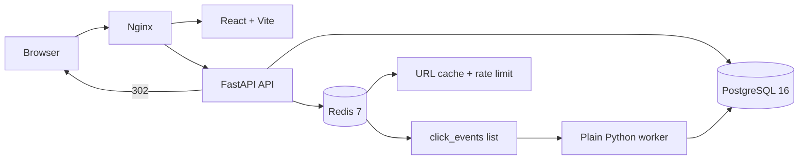

# LinkLab — Scalable URL Shortener with Real-Time Analytics

LinkLab addresses two common link-sharing problems: long URLs are difficult to
share, and redirect analytics should not slow down the redirect itself. It
provides short, validated links backed by PostgreSQL, serves fast HTTP 302
redirects through Redis caching, and records click events asynchronously for a
React analytics dashboard.

This portfolio project demonstrates a service-oriented backend, asynchronous
processing, data modeling, automated testing, and a containerized local
development workflow.

## Features

- Create short links from validated public `http://` and `https://` URLs.
- Return temporary HTTP `302` redirects so destinations can change later.
- Cache link destinations in Redis with a configurable TTL.
- Queue click events in Redis without blocking redirect responses.
- Process queued events with a Python worker that parses device and browser
  information and persists analytics to PostgreSQL.
- Display total clicks, daily clicks, device breakdowns, and browser breakdowns
  in a React dashboard using Recharts.
- Apply a fixed-window rate limit per client IP.
- Hash client IPs with a configurable salt instead of storing raw addresses.
- Reject localhost, private, reserved, and the shortener's own domain as
  destinations to reduce SSRF and open-redirect risks.
- Send failed database insert events to a Redis dead-letter queue.

## Architecture



## Click flow

1. The user submits a validated HTTP(S) URL to `POST /api/links`.
2. The API generates a random code and lets PostgreSQL's unique constraint
   resolve concurrent code collisions.
3. A redirect checks Redis first. A miss reads PostgreSQL and populates Redis
   with a one-hour TTL.
4. The API immediately returns `302` and queues a small click event in Redis.
   The event contains a salted IP hash, never the raw IP.
5. The worker consumes the list with `BRPOP`, parses device/browser, and writes
   the click to PostgreSQL.
6. The dashboard uses SQL aggregation endpoints for totals and breakdowns.

## Tech stack

| Area | Technology |
| --- | --- |
| API | FastAPI, Python 3.12, Pydantic v2 |
| ORM/migrations | SQLAlchemy 2.0, Alembic |
| Database | PostgreSQL 16 |
| Cache/queue | Redis 7 via redis-py |
| Worker | Plain Python script |
| Frontend | React, Vite, Tailwind, Recharts |
| Proxy | Nginx |
| Runtime | Docker and Docker Compose |
| Tests | pytest and httpx |
| CI/CD | GitHub Actions and SSH to EC2 |
| Load testing | k6 |

### Repository layout

```text
app/                    FastAPI routes, validation, models, and Redis client
worker/                 Background click-event consumer
frontend/               React/Vite dashboard
tests/                  API, Redis, worker, health, and analytics tests
loadtest/               k6 scenario and load-test instructions
alembic/                Database migration scripts
docs/                   Deployment notes
.github/workflows/      CI and manual deployment workflows
docker-compose.loadtest.yml  Benchmark-only Compose override
```

## How to run

### Prerequisites

- Docker Desktop with Docker Compose
- Git
- k6, only if you want to run the load tests

### Start the complete application

From the repository root, copy the example environment file if `.env` does
not already exist:

```bash
cp .env.example .env
```

PowerShell equivalent:

```powershell
Copy-Item .env.example .env
```

Review `.env` and change secrets or connection settings as needed. Then build
and start the full stack:

```bash
docker compose up --build
```

The stack includes PostgreSQL, Redis, the FastAPI API, the background worker,
the React frontend, and Nginx. Alembic migrations run automatically before the
API starts.

Open <http://localhost> for the dashboard. The API is also exposed directly
on port 8000:

- API docs: <http://localhost:8000/docs>
- Health check: <http://localhost:8000/health>

To run in the background and follow worker logs:

```bash
docker compose up -d --build
docker compose logs -f worker
```

After changing worker code, rebuild just that service:

```bash
docker compose up -d --build worker
```

Stop the application with:

```bash
docker compose down
```

Quick links:

- `POST /api/links` — create a short link
- `GET /{code}` — redirect and enqueue a click event
- `GET /api/links` — list links with click counts
- `GET /api/links/{code}/stats` — dashboard summary
- `GET /health` — PostgreSQL and Redis health check

## API

The routes are implemented in `app/main.py`.

| Method and path | Purpose | Success response |
| --- | --- | --- |
| `GET /health` | Check PostgreSQL and Redis availability | `200` with dependency status; `503` if unhealthy |
| `POST /api/links` | Create a short link from `{ "long_url": "https://example.com" }` | `201` with `code`, `long_url`, and `short_url` |
| `GET /{code}` | Resolve a short code, enqueue analytics, and redirect | `302` to the original URL |
| `GET /api/links` | List links and click counts | `200` list with `created_at` and `click_count` |
| `GET /api/links/{code}/stats` | Return the dashboard summary | `200` with totals, daily clicks, devices, and browsers |
| `GET /api/links/{code}/stats/total` | Return the all-time click total | `200` with `code` and `total_clicks` |
| `GET /api/links/{code}/stats/daily` | Return daily clicks from the last 30 calendar days | `200` list of dates and click counts |
| `GET /api/links/{code}/stats/devices` | Return device aggregation | `200` list of names and counts |
| `GET /api/links/{code}/stats/browsers` | Return browser aggregation | `200` list of names and counts |

Invalid or unsafe destinations return `422`. Link creation returns `429` when
the per-IP rate limit is exceeded.

## Tests

```bash
python -m pip install -r requirements.txt
python -m pytest -q
```

The tests override the database with an isolated SQLite database for speed;
production and Compose use PostgreSQL 16. Redis behavior is covered with
deterministic fakes and outage cases.

## Load testing

The k6 scenario in [loadtest/redirect.js](loadtest/redirect.js) models a
shortener workload with 99% redirects and 1% link creation. Redirects do not
follow the external destination, so the measured response is the shortener's
`302`.

Use the benchmark-only `docker-compose.loadtest.yml` override for both cache
modes. It sets the API rate limit to `1000` requests per `60` seconds for this
local scenario; the base Compose file and production default remain `10` per
`60` seconds.

Run with caching enabled:

```bash
docker compose -f docker-compose.yml -f docker-compose.loadtest.yml up --build -d
k6 run -e BASE_URL=http://localhost -e CACHE_ENABLED=true loadtest/redirect.js
```

Run with caching disabled by recreating the API:

```bash
CACHE_ENABLED=false docker compose -f docker-compose.yml -f docker-compose.loadtest.yml up -d --build api
k6 run -e BASE_URL=http://localhost -e CACHE_ENABLED=false loadtest/redirect.js
```

PowerShell equivalent:

```powershell
$env:RATE_LIMIT_PER_MINUTE = "1000"
$env:RATE_LIMIT_WINDOW_SECONDS = "60"
$env:CACHE_ENABLED = "true"
docker compose -f docker-compose.yml -f docker-compose.loadtest.yml up --build -d
k6 run -e BASE_URL=http://localhost -e CACHE_ENABLED=true loadtest/redirect.js
$env:CACHE_ENABLED = "false"
docker compose -f docker-compose.yml -f docker-compose.loadtest.yml up -d --build api
k6 run -e BASE_URL=http://localhost -e CACHE_ENABLED=false loadtest/redirect.js
$env:CACHE_ENABLED = "true"
docker compose -f docker-compose.yml -f docker-compose.loadtest.yml up -d --build api
```

The scenario runs for 30 seconds at a 20-request-per-second arrival rate.
Record requests per second, p95 latency, error rate, cache mode, and exact
duration for each run. See [loadtest/README.md](loadtest/README.md) for the
complete scenario notes and seed-link option.

### Local benchmark results

These results were measured on a local Windows machine using Docker Compose,
not on AWS or in a production environment.

- k6 version: `2.2.0`
- Duration: `30 seconds` per run
- Target arrival rate: `20 iterations/second`
- Workload: approximately `99%` redirects and `1%` link creation
- Benchmark-only rate-limit override: `1000` requests per `60` seconds
- Both runs passed all k6 checks and thresholds

| Metric | Cache enabled | Cache disabled |
| --- | ---: | ---: |
| HTTP requests/sec | 19.851601 | 19.983186 |
| p95 latency | 6.21 ms | 8.00 ms |
| Average latency | 4.83 ms | 5.97 ms |
| HTTP error rate | 0.00% | 0.00% |
| Total HTTP requests | 601 | 602 |
| Duration | 30 seconds | 30 seconds |

In these runs, caching enabled showed lower p95 latency than caching disabled
(6.21 ms versus 8.00 ms). This is an observation from these local runs, not a
universal or production performance claim.

## Screenshots

No screenshots are currently included in the repository.

> Screenshot placeholder — add a dashboard screenshot here when available.

> Screenshot placeholder — add an API documentation screenshot here when
> available.

## Security and abuse protections

- Only `http://` and `https://` destinations are accepted.
- Localhost, non-public IP addresses, and the configured shortener domain are
  rejected to reduce SSRF/open-redirect abuse.
- Link creation is rate-limited per client IP with Redis.
- `X-Forwarded-For` is honored only from configured trusted proxy networks.
- Raw client IPs are never queued or stored; analytics uses a salted SHA-256
  hash.
- Redis failures fail open for rate limiting and fall back to PostgreSQL for
  redirects; analytics enqueue failures do not break redirects.
- `.env`, build output, dependencies, and Python caches are ignored by Git.

## CI/CD status

The GitHub Actions CI workflow runs the backend tests against PostgreSQL and
Redis service containers and builds the frontend on pushes and pull requests.

The deployment workflow is currently manual-only through
`workflow_dispatch` while AWS EC2 deployment secrets are being configured.
AWS deployment is not claimed as complete. See [docs/DEPLOY.md](docs/DEPLOY.md)
for the planned EC2 workflow and required secrets; never commit those secrets
or `.env` files.

## Design decisions and trade-offs

- **302 instead of 301:** redirects remain temporary, so destinations can be
  changed later and browsers do not permanently cache an old target.
- **Redis list for the queue:** `LPUSH`/`BRPOP` is easy to explain and enough
  for this portfolio workload without introducing another broker.
- **Database uniqueness for collisions:** a pre-check has a race; the unique
  constraint is atomic and the API retries after an integrity error.
- **At-least-once delivery:** a worker commits each event after processing. A
  crash can cause a retry or duplicate, but a failed database write is moved to
  a dead-letter list instead of silently disappearing.
- **Hashed IPs:** analytics can group repeat visitors without retaining raw
  network identifiers. The salt prevents simple precomputed lookups.

## Limitations and future improvements

- There is no authentication or per-owner authorization yet; the dashboard is
  intentionally a portfolio-wide view.
- The fixed-window rate limiter is simple and may be bursty at window edges.
- The Redis list has no visibility timeout, so a worker crash after `BRPOP`
  and before commit can lose an event; the dead-letter path covers insert
  failures, not process crashes.
- User-agent parsing is intentionally lightweight and not a full browser
  detection database.
- The deployment example terminates plain HTTP at Nginx; production HTTPS and
  a managed PostgreSQL/Redis setup would be appropriate next steps.
- Frontend charts are client-rendered and currently use a compact single-page
  hash navigation model.
- Future work could add authentication, durable queue delivery, richer
  observability, HTTPS, managed infrastructure, and measured benchmark results.

## Disclosure

Built with AI-assisted development (Codex); architecture decisions, testing and deployment by me.
