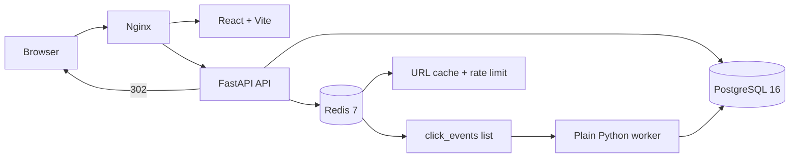

# Scalable URL Shortener with Real-Time Analytics

This project is a production-style URL shortener that turns long URLs into
short links and records click analytics asynchronously. It demonstrates a
service-oriented architecture with a FastAPI API, PostgreSQL persistence,
Redis caching and queuing, a Python analytics worker, and a React dashboard.
The complete stack runs with Docker Compose and includes health checks,
database migrations, rate limiting, a dead-letter queue, automated tests, and
a GitHub Actions deployment path to AWS EC2.

## Architecture



## Click flow

1. The user submits a validated HTTP(S) URL to `POST /api/links`.
2. The API generates a random code and lets PostgreSQL's unique constraint
   resolve concurrent code collisions.
3. A redirect checks Redis first. A miss reads PostgreSQL and populates Redis
   with a one-hour TTL.
4. The API immediately returns `302` and queues a small click event in Redis.
   The event contains a salted IP hash, never the raw IP.
5. The worker consumes the list with `BRPOP`, parses device/browser, and writes
   the click to PostgreSQL.
6. The dashboard uses SQL aggregation endpoints for totals and breakdowns.

## Tech stack

| Area | Technology |
| --- | --- |
| API | FastAPI, Python 3.12, Pydantic v2 |
| ORM/migrations | SQLAlchemy 2.0, Alembic |
| Database | PostgreSQL 16 |
| Cache/queue | Redis 7 via redis-py |
| Worker | Plain Python script |
| Frontend | React, Vite, Tailwind, Recharts |
| Proxy | Nginx |
| Runtime | Docker and Docker Compose |
| Tests | pytest and httpx |
| CI/CD | GitHub Actions and SSH to EC2 |
| Load testing | k6 |

## How to run

### Prerequisites

- Docker Desktop with Docker Compose
- Git

### Start the complete application

From the repository root, copy the example environment file if `.env` does
not already exist:

```bash
cp .env.example .env
```

Review `.env` and change secrets or connection settings as needed. Then build
and start the full stack:

```bash
docker compose up --build
```

The stack includes PostgreSQL, Redis, the FastAPI API, the background worker,
the React frontend, and Nginx. Alembic migrations run automatically before the
API starts.

Open <http://localhost> for the dashboard. The API is also exposed directly
on port 8000:

- API docs: <http://localhost:8000/docs>
- Health check: <http://localhost:8000/health>

To run in the background and follow worker logs:

```bash
docker compose up -d --build
docker compose logs -f worker
```

After changing worker code, rebuild just that service:

```bash
docker compose up -d --build worker
```

Stop the application with:

```bash
docker compose down
```

Useful endpoints:

- `POST /api/links` — create a short link
- `GET /{code}` — redirect and enqueue a click event
- `GET /api/links` — list links with click counts
- `GET /api/links/{code}/stats` — dashboard summary
- `GET /health` — PostgreSQL and Redis health check

## Tests

```bash
python -m pip install -r requirements.txt
python -m pytest -q
```

The tests override the database with an isolated SQLite database for speed;
production and Compose use PostgreSQL 16. Redis behavior is covered with
deterministic fakes and outage cases.

## Security and abuse protections

- Only `http://` and `https://` destinations are accepted.
- Localhost, non-public IP addresses, and the configured shortener domain are
  rejected to reduce SSRF/open-redirect abuse.
- Link creation is rate-limited per client IP with Redis.
- `X-Forwarded-For` is honored only from configured trusted proxy networks.
- Raw client IPs are never queued or stored; analytics uses a salted SHA-256
  hash.
- Redis failures fail open for rate limiting and fall back to PostgreSQL for
  redirects; analytics enqueue failures do not break redirects.
- `.env`, build output, dependencies, and Python caches are ignored by Git.

## CI/CD

Every push and pull request runs Python tests against PostgreSQL/Redis service
containers and builds the frontend. A push to `main` runs the same checks, then
SSHes to EC2, writes runtime secrets from GitHub Secrets, backs up the previous
release, builds Compose images, runs Alembic, starts the stack, and checks
`/health`. See [docs/DEPLOY.md](docs/DEPLOY.md).

## Design decisions and trade-offs

- **302 instead of 301:** redirects remain temporary, so destinations can be
  changed later and browsers do not permanently cache an old target.
- **Redis list for the queue:** `LPUSH`/`BRPOP` is easy to explain and enough
  for this portfolio workload without introducing another broker.
- **Database uniqueness for collisions:** a pre-check has a race; the unique
  constraint is atomic and the API retries after an integrity error.
- **At-least-once delivery:** a worker commits each event after processing. A
  crash can cause a retry or duplicate, but a failed database write is moved to
  a dead-letter list instead of silently disappearing.
- **Hashed IPs:** analytics can group repeat visitors without retaining raw
  network identifiers. The salt prevents simple precomputed lookups.

## Known limitations

- There is no authentication or per-owner authorization yet; the dashboard is
  intentionally a portfolio-wide view.
- The fixed-window rate limiter is simple and may be bursty at window edges.
- The Redis list has no visibility timeout, so a worker crash after `BRPOP`
  and before commit can lose an event; the dead-letter path covers insert
  failures, not process crashes.
- User-agent parsing is intentionally lightweight and not a full browser
  detection database.
- The deployment example terminates plain HTTP at Nginx; production HTTPS and
  a managed PostgreSQL/Redis setup would be appropriate next steps.
- Frontend charts are client-rendered and currently use a compact single-page
  hash navigation model.

## Load test results

Run the two scenarios in [loadtest/README.md](loadtest/README.md), then fill in
the observed values:

| Scenario | Requests/sec | p95 latency | Error rate | Duration |
| --- | ---: | ---: | ---: | ---: |
| Cache on | _fill in_ | _fill in_ | _fill in_ | 30s |
| Cache off | _fill in_ | _fill in_ | _fill in_ | 30s |
